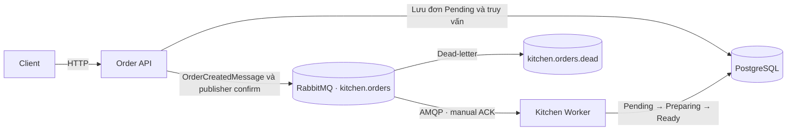

# 01 — Kiến trúc KitchenFlow Tuần 2

- **Order API** giữ bốn endpoint Tuần 1 và lưu đơn cùng các dòng món trước khi publish.
- **RabbitMQ** lưu message persistent trong quorum queue durable. Chế độ single active consumer và prefetch 1 cho phép một Worker nhận từng đơn.
- **Kitchen Worker** là một tiến trình .NET độc lập. Worker dùng `OrderId` để truy vấn và cập nhật PostgreSQL.
- **PostgreSQL** giữ schema Tuần 1 và là nguồn dữ liệu cho trạng thái đơn. Worker tham chiếu project `Order.Api` để dùng chung DbContext và entity. Điểm khởi động và vòng đời hai tiến trình độc lập.
- **Contracts** định nghĩa message và JSON. **Messaging** dùng chung cấu hình kết nối và khai báo hàng đợi.
